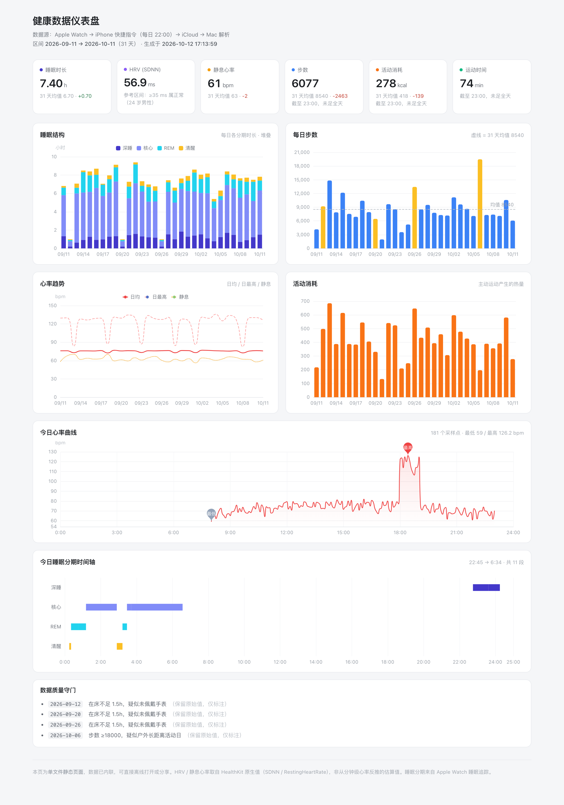

# healthpipe

> 把 Apple Health 的数据落到本机，再**喂给 AI 托管**。
>
> 一条命令生成给模型读的上下文，或者直接挂成 MCP server，让 Claude / Cursor 这类客户端随时查你的睡眠、HRV、心率、活动量。全程 0 元，数据不出本机。

替代那些「要么付费、要么把健康数据上传到别人服务器」的导出 App。核心是一个**容错解析器**——
iPhone 快捷指令拼出来的 JSON 几乎一定是坏的（数字后多一个引号、全角 `］`、尾随逗号），而现有工具都假设它是合法的。

---

## 数据去哪了

```
Apple Watch → Apple 健康 App → iPhone 快捷指令（每天定时导出）
            → iCloud → Mac 上一个 .txt 文件
            → healthpipe 解析 → 本地时序 JSON
                              ├─ 给 AI：context / MCP   ← 主要用途
                              └─ 给人：单文件 HTML 仪表盘
```

macOS 读不到 Apple 健康数据库，所以必须走「手机 → 文件 → 电脑」这一步；之后的解析、统计、脱敏全在本机完成。

---

## 特性

- **容错解析** —— 自动修复快捷指令导出的三类固定语法错误，坏文件不会中断整条链路
- **AI 上下文** —— `healthpipe context` 直接产出模型能读的 Markdown 摘要（当日明细 + 趋势 + 数据质量）
- **MCP server** —— `healthpipe mcp` 把健康数据挂成标准 MCP 工具，任何支持 MCP 的客户端即插即用，**零依赖**
- **多源合并** —— 快捷指令导出 + 第三方 App 导出，同一日期自动去重合并
- **数据质量守门** —— 自动标注「疑似未佩戴手表」「步数异常」等日子，只标注不删数据
- **单文件仪表盘** —— 图表库内联，产物是一张可离线打开、可直接发出去的 HTML
- **一键脱敏** —— 生成公开版本时按比例缩放真实值，保留趋势形态

---

## 快速开始

```bash
git clone https://github.com/<用户名>/apple-health-pipeline.git
cd apple-health-pipeline
python3 -m venv .venv
source .venv/bin/activate
pip install -e .
cp config.example.toml config.toml
```

打开 `config.toml`，把 `shortcut_dir` 指向你的快捷指令导出目录，然后：

```bash
healthpipe sync        # 解析 + 合并 → output/series.json
healthpipe context     # 打印给 AI 看的摘要
```

> iPhone 端的快捷指令配置步骤见 [`shortcuts/README.md`](shortcuts/README.md)。

---

## 命令

| 命令 | 作用 |
|---|---|
| `healthpipe doctor` | 体检：路径是否可达、文件是否损坏、数据质量如何 |
| `healthpipe sync` | 解析所有导出文件，合并成统一时序 → `output/series.json` |
| `healthpipe context --days 7` | **输出给 AI 的健康数据上下文**（Markdown，可直接粘进对话） |
| `healthpipe mcp` | **启动 MCP server（stdio）**，供 AI 客户端挂载 |
| `healthpipe dashboard` | 生成单文件 HTML 仪表盘 |
| `healthpipe report --days 30` | 生成 Markdown 汇总表 |

---

## AI 集成

两种方式，按客户端能力选。

### 方式一：MCP server（推荐）

让 AI 客户端**自己决定**什么时候查什么数据，不用你手动复制粘贴。

`healthpipe mcp` 启动一个走 stdio 的 MCP server，只读、零依赖。把下面这段按客户端要求放到对应配置文件里，**`command` 要写 healthpipe 的绝对路径**（venv 里的那份，避免 PATH 找不到）：

```json
{
  "mcpServers": {
    "healthpipe": {
      "command": "/绝对路径/apple-health-pipeline/.venv/bin/healthpipe",
      "args": ["--config", "/绝对路径/apple-health-pipeline/config.toml", "mcp"]
    }
  }
}
```

各客户端配置文件位置：

| 客户端 | 配置文件 |
|---|---|
| Claude Desktop（macOS） | `~/Library/Application Support/Claude/claude_desktop_config.json` |
| Cursor | `~/.cursor/mcp.json`（或项目内 `.cursor/mcp.json`） |
| WorkBuddy | `~/.workbuddy/mcp.json` |

改完**重启客户端**生效。挂载成功后可以直接问「我最近一周睡得怎么样」「HRV 这一个月是什么趋势」。

提供的工具：

| 工具 | 参数 | 返回 |
|---|---|---|
| `health_overview` | `days`（默认 7） | 最新一天明细 + 各指标趋势 + 数据质量问题 |
| `health_daily` | `date`（默认最新一天） | 某天的完整明细，含睡眠分期 |
| `health_series` | `metric`、`days`（默认 30） | 单指标逐日时序 CSV |
| `health_quality` | `days`（默认 30） | 数据存疑的日子列表 |

### 方式二：手动喂上下文

没有 MCP 的客户端（网页版 ChatGPT、豆包等），直接把摘要打进对话：

```bash
healthpipe context --days 14              # 打印到终端
healthpipe context --days 14 --out ctx.md # 或写文件
```

输出长这样（下面数值是脱敏后的示例，不是真实值）：

```markdown
# 健康数据上下文

数据区间：**2026-10-05 → 2026-10-11**（7 条记录）

## 最新一天 · 2026-10-11

| 指标 | 值 |
|---|---|
| 睡眠（实睡） | 7.20 h |
| 深睡占比 | 18.4% |
| HRV (SDNN) | 47.2 ms |
| 静息心率 | 72 bpm |
| 步数 | 6,412 |

## 近 7 天趋势

| 指标 | 均值 | 范围 | 对比前 7 天 |
|---|---|---|---|
| 睡眠（实睡） | 6.85 h | 5.40 h – 7.90 h | -0.31 h |
| 静息心率 | 71 bpm | 66 bpm – 76 bpm | +2 bpm |
```

> 用多少天数据就报多少天，缺值一律填 `—`，**不推测、不编数**。

---

## 仪表盘包含

| 图表 | 说明 |
|---|---|
| KPI 卡片 ×6 | 睡眠时长、HRV、静息心率、步数、活动消耗、运动时间，并与区间均值对比 |
| 睡眠结构 | 深睡 / 核心 / REM / 清醒的每日堆叠 |
| 每日步数 | 带均值虚线，离群日自动变色 |
| 心率趋势 | 日均 / 日最高 / 静息 三条线 |
| 活动消耗 | 主动运动产生的热量 |
| 心率曲线 | 全天逐点心率，标出最低 / 最高 |
| 睡眠分期时间轴 | 每段睡眠按分期画在对应行上 |



---

## 数据来源

项目支持两个来源，也可只用其中一个：

| 来源 | 字段完整度 | 说明 |
|---|---|---|
| **iPhone 快捷指令** | 完整 | 含 HRV、静息心率等 HealthKit 原生指标 |
| 第三方 App 导出（如 HealthExport） | 较少 | 通常缺 HRV，但可以提供历史存量数据 |

两者按日期合并，**快捷指令的数据优先**。

> ⚠️ `examples/` 里的 demo 是**两个来源合并**的结果：快捷指令从 2026-10-11 才开始产出，之前的 30 天来自第三方 App 的存量导出。
> **只用快捷指令的话，第一次运行只有 1 条数据。**

### 采集字段

| 字段 | 含义 | 统计方式 | 单位 |
|---|---|---|---|
| `steps` | 步数 | 求和 | 步 |
| `distance_km` | 步行 + 跑步距离 | 求和 | km |
| `active_energy_kcal` | 活动能量 | 求和 | kcal |
| `exercise_min` | 锻炼分钟数 | 求和 | min |
| `basal_energy_kcal` | 静息（基础）能量 | 求和 | kcal |
| `hrv_ms` | 心率变异性（HealthKit 原生 SDNN） | 平均 | ms |
| `resting_hr` | 静息心率（HealthKit 原生） | 平均 | bpm |
| `heart_rate` | 全天逐条心率 | 逐条 | bpm |
| `sleep` | 睡眠分期分段 | 逐段 | — |

> 累计型指标（步数、能量、距离）随一天推移不断增长，**必须每天固定同一时间点采集**，跨天的数据才可比。
>
> HRV 用的是 HealthKit 原生 SDNN 值。**不要用分钟级心率去反推 RMSSD** —— 两者量纲不同，实测能差 13 倍（3.7 vs 47.2 ms），据此得的结论全是错的。

---

## 项目结构

```
src/healthpipe/
├── repair.py      ★ 容错解析器（本项目的核心）
├── sources.py     数据源适配与合并
├── metrics.py     派生指标、质量守门、脱敏
├── context.py     ★ 生成给 LLM 的上下文
├── mcp_server.py  ★ MCP server（stdio，零依赖）
├── report.py      Markdown 汇总
├── dashboard.py   单文件 HTML 生成
├── config.py      配置加载
└── cli.py         命令行入口
```

---

## 常见问题

**运行报 `XPC error`** → 去 iPhone「设置 → 快捷指令 → 高级」，打开「允许共享大量数据」。

**找不到导出文件** → 检查 `config.toml` 的 `shortcut_dir`。路径里如果带前导空格（例如 ` tmp`），空格要原样写上。

**某天没有数据** → iOS 锁屏时会限制健康数据访问，自动化运行时手机锁着可能取不到。连续观察几天。

**AI 客户端里看不到 healthpipe 工具** → ① `command` 必须写绝对路径；② 改完配置要重启客户端；③ 先在终端跑一次 `healthpipe doctor` 确认路径没配错。

**想发到公开场合** → 把 `config.toml` 里 `[privacy] anonymize` 设为 `true`，会按比例缩放真实数值。

---

## License

MIT
